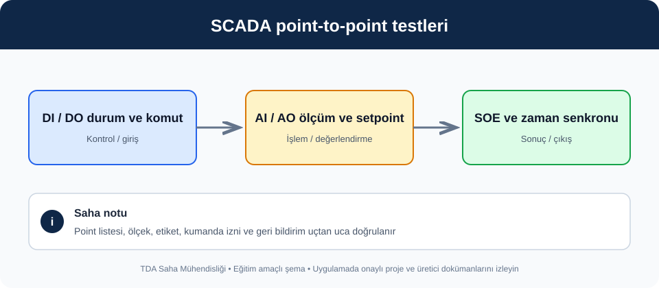

# 📖 Gün 29 — SCADA Point Testleri: Prosedür, Protokoller ve Tipik Hatalar (Teknik Detaylar)

Bu doküman, 29. Gün çalışması kapsamında incelenen **point test prosedürü**, **IEC 60870-5-104 ve 61850 detayları**, **zaman senkronizasyonu** ve **tipik hata senaryoları** konularını içerir.

---

## 1. Point Listesi Yapısı

### 1.1. Tipik Point Tablosu

| Point No | Tip | Tanım                          | Adres (IOA) | Grup    |
| :------- | :-- | :----------------------------- | :---------- | :------ |
| 1001     | DI  | F1 Kesici Pozisyon             | 100         | Fider F1|
| 1002     | DI  | F1 Hat Ayırıcı Pozisyon        | 101         | Fider F1|
| 1003     | DI  | F1 Toprak Ayırıcı Pozisyon     | 102         | Fider F1|
| 3001     | AI  | F1 Faz A Akımı                 | 300         | Fider F1|
| 3002     | AI  | F1 Faz B Akımı                 | 301         | Fider F1|
| 4001     | AI  | F1 Aktif Güç                   | 400         | Fider F1|
| 5001     | DO  | F1 Kesici Trip                 | 500         | Fider F1|
| 5002     | DO  | F1 Kesici Close                | 501         | Fider F1|

### 1.2. Adresleme Kuralları

-   Her point **benzersiz** IOA (Information Object Address) alır.
-   Gruplama: Fider, trafo, bara bazında bloklar.
-   **Common Data (ortak):** Bara gerilimi, sistem frekansı.

---

## 2. DI (Digital Input) Testleri

### 2.1. Prosedür

1.  Sahada kontak fiziksel değiştirilir (kesici manuel trip).
2.  RTU/Gateway log kontrol: sinyal geldi mi, doğru adres mi?
3.  Master Station ekran kontrol: doğru etiket, doğru renk.
4.  **SOE kaydı:** Zaman damgası doğru (±1 ms hassasiyet).

### 2.2. Tipik DI Listesi

| Point                | Tetikleme Yöntemi                   |
| :------------------- | :---------------------------------- |
| Kesici pozisyon      | Manuel trip/close                   |
| Ayırıcı pozisyon     | Manuel manevra                      |
| Toprak pozisyon      | Manuel manevra                      |
| SF6 düşük alarm      | Simülasyon kontak (test)            |
| Trafo sıcaklık alarm | Termometre simülasyonu              |
| Kapı açık alarm      | Kapak açma                          |
| Spring charge        | Kesici kapama sonrası               |

---

## 3. DO (Digital Output) — Komut Testleri

### 3.1. Select-Before-Operate (SBO)

```
Operatör → Select (F1 Trip) → RTU doğrula → Saha IED doğrula
         ← Select onay
Operatör → Execute → Trip komutu → Kesici açılır
         ← Execute onay
```

-   **Timeout:** Select onayı sonrası 60 s içinde execute yapılmazsa iptal.
-   **İptal:** Select sonra başka point select edilirse önceki iptal.

### 3.2. Komut Test Senaryoları

| Test                              | Beklenen                              |
| :-------------------------------- | :------------------------------------ |
| Trip komutu — kesici kapalı       | Kesici açılır                         |
| Close komutu — interlock uygun    | Kesici kapanır                        |
| Close komutu — toprak kapalı      | Bloke edilir (interlock)              |
| Select yapılmadan execute         | Komut reddedilir                      |
| Execute timeout                   | Komut iptal edilir                    |
| İki operatör aynı anda komut      | İkincisi bekletilir/reddedilir        |

### 3.3. Emergency Control

Acil durum komutları (örn. tüm fiderler trip) için:
-   **Extra confirmation** (iki onay).
-   **Operatör yetkisi** sınırlı (rol bazlı erişim).

---

## 4. AI (Analog Input) Testleri

### 4.1. Prosedür

1.  Test cihazı ile IED'ye bilinen analog değer verilir.
2.  IED ölçümü kontrol edilir.
3.  RTU/Gateway dönüşümü kontrol edilir (ölçek faktörleri).
4.  Master Station gösterimi kontrol edilir.

### 4.2. Ölçek Faktörleri

IEC 104'te analog değerler **ölçekli** gönderilir:

$$Değer_{gönder} = Değer_{gerçek} \times ScaleFactor$$

-   Tipik: Akım için 1 (doğrudan), güç için 1000.
-   **Kritik:** Ölçek faktörü RTU ve Master aynı olmalı.

### 4.3. Kabul Kriteri

| Parametre       | Tolerans            |
| :-------------- | :------------------ |
| Akım ölçüm      | ±%1                 |
| Gerilim ölçüm   | ±%1                 |
| Güç ölçüm       | ±%2                 |
| Frekans         | ±0.01 Hz            |

---

## 5. Zaman Senkronizasyonu ve SOE

### 5.1. Zaman Kaynağı Hiyerarşisi

```
GPS Antena → Zaman Server (PTP Master) → IED'ler (PTP Slave)
                                        → RTU (NTP)
```

### 5.2. SOE (Sequence of Events)

-   Her olay **milisaniye hassasiyetiyle** kaydedilir.
-   Olay sırası doğru analiz için kritik (hangi olay önce oldu?).
-   **Test:** Sahada sıralı iki olay tetiklenir (örn. 5 ms arayla), SOE kaydında sıra ve zaman farkı doğrulanır.

### 5.3. Kabul Kriteri

| Parametre         | Kriter            |
| :---------------- | :---------------- |
| IED saat sapması  | < ±1 ms           |
| SOE hassasiyeti   | 1 ms              |
| Zaman server güvenilirlik | N+1 yedek |

---

## 6. Tipik Hata Senaryoları

| Senaryo                                | Sonuç                                       |
| :------------------------------------- | :------------------------------------------ |
| IOA adresi çakışık (iki point aynı)    | Yanlış sinyal görüntüsü                     |
| Ölçek faktörü yanlış                   | Ölçümler 1000× yanlış                       |
| Zaman senkron yok                      | SOE sırası anlamsız                         |
| SBO timeout çok kısa                   | Operatör komut yapamıyor                    |
| Interlock SCADA'da bypass              | Yanlış manevra riski                        |
| Test modunda point aktivasyon          | Operatör sahte alarm                        |

---

## 7. SCADA Devreye Alma Kontrol Listesi

-   [ ] Point listesi onaylı (revizyon kontrol).
-   [ ] Tüm DI'lar point-to-point test edildi.
-   [ ] Tüm DO'lar komut testi ile doğrulandı.
-   [ ] Tüm AI'lar ölçek faktörü doğrulandı.
-   [ ] Tüm AO'lar setpoint testi yapıldı.
-   [ ] SOE kayıtları doğru zamanlı.
-   [ ] Zaman senkronizasyon aktif.
-   [ ] Alarm listesi doğru kategorize edilmiş.
-   [ ] Raporlar (günlük/aylık) çalışıyor.
-   [ ] Backup/failover testi yapıldı.

---



## 🔗 İlgili Kaynaklar

-   _IEC 60870-5-104 — Telecontrol Protocol_
-   _IEC 61850 — Communication Networks_
-   _IEEE 1588 — Precision Time Protocol_
