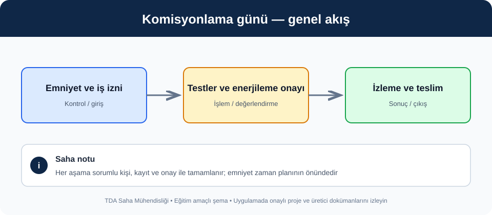

# 📍 Gün 30 — Komple TDA Simülasyonu: Komisyonlama Günü Akışı

## 🎯 Günün Hedefleri

-   [x] 30 günlük öğrendiklerini **tek bir devreye alma günü** senaryosunda birleştirmek.
-   [x] Komisyonlama günü saat-saat akışını yönetmeyi öğrenmek.
-   [x] Şef mühendislik kararlarını ve emniyet dengelemesini uygulamak.
-   [x] Devreye alma sonrası teslim ve raporlama sürecini tamamlamak.

---

## 📚 Özet Çalışma Notları

### 1. Komisyonlama Günü Akışı (Tipik)

| Saat   | Aktivasyon                                  | Sorumlu            |
| :----- | :------------------------------------------ | :----------------- |
| 06:00  | İş planı onayı (PTW), ekip dağılımı         | Şef Mühendis       |
| 07:00  | Son güvenlik kontrolü, 5 altın kural        | Tüm ekip           |
| 08:00  | CT/VT son ölçümler, IR testleri             | TDA Teknisyen      |
| 09:00  | IED ayar yükleme + hash doğrulama           | Koruma Mühendisi   |
| 10:00  | Sekonder enjeksiyon son kontrol             | Koruma Mühendisi   |
| 11:00  | Interlock ve kumanda testleri               | TDA Mühendisi      |
| 12:00  | SCADA point testleri                        | SCADA Mühendisi    |
| 13:00  | Enerjileme onayı — dossier kontrolü         | Şef + Müşteri      |
| 14:00  | Fider enerjileme (manevra fişi ile)         | Şef Mühendis       |
| 15:00  | Trafo enerjileme (no-load)                  | Şef Mühendis       |
| 16:00  | 24 saat izleme başlangıcı                   | Operasyon          |
| 17:00  | Test dossier teslim ve kapanış              | Proje Müdürü       |

### 2. Şef Mühendisin Karar Noktaları

-   **Devam mı, dur mu?** Her saat başı durum değerlendirmesi.
-   **Kritik NC** tespit edilirse → enerjileme **durdurulur**.
-   **Zaman baskısı** asla emniyeti geçmez — **Kural: Emniyet > Zaman > Maliyet**.

### 3. Devreye Alma Sonrası Teslim

-   [ ] Test dossier (tam, imzalı)
-   [ ] As-built schematic
-   [ ] Ayar dosyası + hash
-   [ ] Operatör eğitimi yapıldı
-   [ ] Bakım periyot tablosu teslim edildi
-   [ ] Garanti başlangıç tarihi kaydedildi

---

## 🔗 Detaylı Notlar

Saat-saat kontrol listeleri, rol tanımları ve tipik kriz yönetimi için:
👉 **[30. Gün Detaylı Teknik Notları (detail.md)](./detail.md)**

---

## 🎉 30 Günlük Yolculuk Tamamlandı!

Bu 30 günlük maratonda:

-   **Şalt mimarisi** ve primer ekipmanlar (Gün 1-3)
-   **Sekonder sistemler** ve koruma röleleri (Gün 4-9)
-   **Haberleşme ve emniyet** (Gün 10-12)
-   **Testler ve komisyonlama** (Gün 13-15)
-   **İleri koruma fonksiyonları** (Gün 16-19)
-   **Devreye alma prosedürleri** (Gün 20-23)
-   **Kompanzasyon ve ölçüm** (Gün 24-25)
-   **Topraklama ve dokümantasyon** (Gün 26-28)
-   **SCADA ve komple simülasyon** (Gün 29-30)

Tebrikler! Artık bir TDA saha mühendisi olarak temel yetkinliklere sahipsin. Saha tecrübesiyle birleştirdiğinde gerçek bir uzman olacaksın. ⚡
