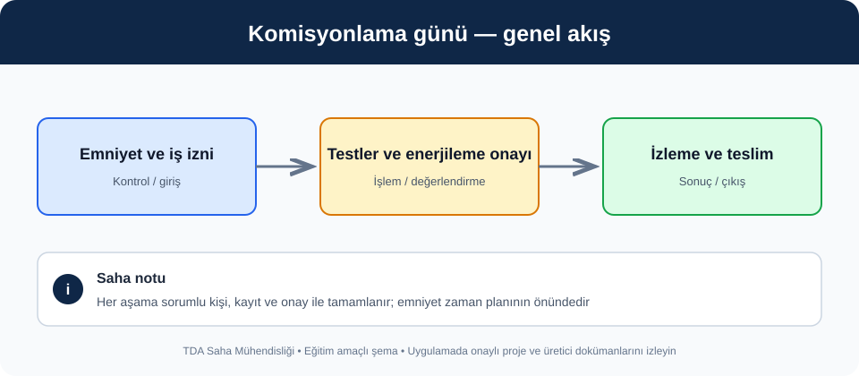

# 📖 Gün 30 — Komisyonlama Günü: Rol Tanımları, Kriz Yönetimi ve Teslim (Teknik Detaylar)

Bu doküman, 30. Gün çalışması kapsamında incelenen **komisyonlama günü organizasyonu**, **rol/yetki matrisi**, **kriz yönetimi** ve **teslim süreci** konularını içerir.

---

## 1. Rol ve Yetki Matrisi

### 1.1. Ekip Yapısı

| Rol                 | Sorumluluk                                | Yetki                      |
| :------------------ | :---------------------------------------- | :------------------------- |
| **Proje Müdürü**    | Genel koordinasyon, müşteri ilişkisi      | Bütçe, kapsam              |
| **Şef Mühendis**    | Teknik kararlar, emniyet                  | Devreye alma onayı         |
| **Koruma Mühendisi**| IED ayar, sekonder enjeksiyon             | Ayar dosyası yükleme       |
| **TDA Mühendisi**   | Saha testleri, ölçüm                      | Test raporu imza           |
| **TDA Teknisyeni**  | Kablolama, ölçüm, montaj                  | Test yardımı               |
| **SCADA Mühendisi** | Point testleri, haberleşme                | Sistem yapılandırma        |
| **Müşteri Temsilci**| Kabul, denetim                            | Devreye alma onay (müşteri)|
| **Operatör**        | İşletme, izleme                           | Manevra (yetki dahilinde)  |

### 1.2. İletişim Protokolü

-   **Radyo/telefon** ile saha-kontrol odası bağlantısı.
-   **Komut tekrar** kuralı: Her komut tekrar edilip onaylanır.
-   **"Clear" komutu:** Manevra sırasında saha boş olduğunu onaylar.

---

## 2. Saat-Saat Detaylı Kontrol Listesi

### 2.1. Sabah (06:00 - 08:00)

**06:00 — İş Planı Onayı**
-   [ ] PTW (Permit to Work) imzalı.
-   [ ] Ekip sayısı ve rol ataması.
-   [ ] Acil durum planı hatırlatıldı.
-   [ ] Risk değerlendirmesi (JSA) güncel.

**07:00 — Güvenlik Kontrolü**
-   [ ] Tüm ekip PPE kontrolü (arc-flash, eldiven, kask).
-   [ ] 5 altın kural hatırlatıldı.
-   [ ] LOTO uygulandı.
-   [ ] Saha bariyerlendi, tabela takıldı.

**08:00 — Primer Ölçümler**
-   [ ] CT/VT oran ve polarite (son kontrol).
-   [ ] IR testleri (primer ve sekonder devreler).
-   [ ] Topraklama direnci ölçümü.
-   [ ] Kablo VLF testi (yeni kablo varsa).

### 2.2. Öğle (09:00 - 13:00)

**09:00 — IED Ayar Yükleme**
-   [ ] Ayar dosyası revizyon kontrolü.
-   [ ] Hash hesabı ve karşılaştırma.
-   [ ] Yükleme + readback doğrulama.
-   [ ] 4-göz imza.

**10:00 — Sekonder Enjeksiyon**
-   [ ] 50/51, 50N/51N pick-up ve trip.
-   [ ] 87 diferansiyel (varsa) stabilite/hassasiyet.
-   [ ] 27/59, 81 fonksiyon testleri.
-   [ ] Trip matrix doğrulama.

**11:00 — Interlock ve Kumanda**
-   [ ] Kesici-ayırıcı interlock.
-   [ ] Ayırıcı-toprak interlock.
-   [ ] Kapak kilitleri.
-   [ ] Manuel ve uzaktan kumanda.

**12:00 — SCADA Testleri**
-   [ ] Point-to-point (DI/DO/AI/AO).
-   [ ] Komut testleri (SBO).
-   [ ] SOE ve zaman senkron.

**13:00 — Enerjileme Onayı**
-   [ ] Dossier tam mı? (tüm testler PASS)
-   [ ] NC'ler kapalı mı?
-   [ ] Punch list kritik item yok mu?
-   [ ] Şef + Müşteri imza.

### 2.3. Öğleden Sonra (14:00 - 17:00)

**14:00 — Fider Enerjileme**
-   [ ] Manevra fişi hazırlanır.
-   [ ] Saha boşaltılır.
-   [ ] Adım adım manevra, komut tekrarı.
-   [ ] Ölçüm kontrol: gerilim, faz sırası.

**15:00 — Trafo Enerjileme**
-   [ ] AG tarafı kesici açık.
-   [ ] YG kesici kapatılır.
-   [ ] Inrush izleme.
-   [ ] AG gerilim kontrol.

**16:00 — İzleme Başlangıcı**
-   [ ] 24 saat izleme kaydı açılır.
-   [ ] Sıcaklık, ses, titreşim, yağ sızıntısı.
-   [ ] SCADA trend kontrol.

**17:00 — Teslim ve Kapanış**
-   [ ] Test dossier teslim.
-   [ ] As-built schematic.
-   [ ] Operatör eğitimi (kısa).
-   [ ] Garanti başlangıç tarihi.

---

## 3. Kriz Yönetimi

### 3.1. Tipik Kriz Senaryoları

| Senaryo                             | Aksiyon                                  |
| :---------------------------------- | :--------------------------------------- |
| Test başarısız (kritik NC)          | Enerjileme durur, düzeltme planı         |
| Ayar dosyası hash uyumsuz           | Kaynak kontrol, yeniden yükleme          |
| CT polarite hatası                  | Kablo düzeltme, yeniden test             |
| SCADA point çakışması               | Adres revizyonu, yeniden test            |
| Kablo VLF çökmesi                   | Hata yeri tespiti, onarım, tekrar test   |
| Trafo inrush anormal                | Koruma ayarı kontrol, izleme             |
| Yangın alarmı (yanlış)              | Dedektör kontrol, reset                  |

### 3.2. Karar Ağacı

```
Sorun tespit edildi
  ├─ Emniyet riski var mı?
  │   ├─ EVET → DUR. Saha boşalt. Şef karar bekler.
  │   └─ HAYIR ↓
  ├─ Fonksiyon riski var mı?
  │   ├─ EVET → Test tekrar. Düzeltme planı.
  │   └─ HAYIR → Punch list kaydı, devam.
  └─ Karar: Şef Mühendis + Müşteri Temsilcisi
```

### 3.3. Duruş (Stop Work) Yetkisi

-   **Her ekip üyesi** emniyet riski görürse **duruş çağrısı** yapabilir.
-   Duruş çağrısı **sorgulanmaz** — önce durur, sonra değerlendirir.
-   Yanlış alarm için **ceza yok** — kültür: "Duyarsızlık suçtur."

---

## 4. Teslim Dokümanları (Deliverables) — Detay

### 4.1. As-Built Schematic

-   Sahada gerçek durum ile çizim (revize).
-   Kablo numaraları, terminal bağlantıları gerçek.
-   Son revizyon numarası ve tarih.

### 4.2. Ayar Dosyası Arşivi

-   Tüm IED ayar dosyaları (final revizyon).
-   Hash değerleri ile birlikte.
-   Versiyon kontrol sistemine (Git veya benzeri) yüklenmiş.

### 4.3. Bakım Periyot Tablosu

| Ekipman          | Test                        | Periyot |
| :--------------- | :-------------------------- | :------ |
| Trafo yağ        | DGA analizi                 | Yıllık  |
| Trafo koruma     | Sekonder enjeksiyon         | 4 yıl   |
| Kesici           | Kontakt direnç, timing      | 4 yıl   |
| Kablo            | IR + sheath test            | Yıllık  |
| Parafudr         | Kaçak akım ölçümü           | Yıllık  |
| Topraklama       | Direnç ölçümü               | Yıllık  |
| Akü              | Kapasite testi              | Yıllık  |
| Röle genel       | Fonksiyon testi             | 4 yıl   |

### 4.4. Operatör Eğitimi

-   Sistem mimarisi (kısa sunum).
-   Manevra prosedürleri (pratik).
-   Alarm anında müdahale.
-   Acil durum iletişimi.
-   Eğitim kayıt formu imzalı.

---

## 5. Garanti ve Sonrası

### 5.1. Garanti Başlangıcı

-   Genelde **enerjileme tarihi** garanti başlangıcı.
-   Tipik süre: 12-24 ay (proje şartnamesine göre).
-   Garanti kapsamı: TDA testleri + ekipman üretici garantisi.

### 5.2. 24 Saat İzleme Raporu

İlk 24 saatte:
-   [ ] Sıcaklık trendi stabilize.
-   [ ] Anormal ses/titreşim yok.
-   [ ] Koruma alarmı yok.
-   [ ] SCADA veri akışı sürekli.
-   [ ] Yağ sızıntısı yok (trafo).

Bu rapor imzalanır ve garanti belgesine eklenir.

---

## 6. 30 Günlük Yolculuğun Özeti

```
Gün 01-03:  Primer ekipmanlar ve şalt mimarisi
Gün 04-09:  Sekonder sistemler ve koruma
Gün 10-12:  Haberleşme ve emniyet
Gün 13-15:  Test metotları ve komisyonlama
Gün 16-19:  İleri koruma fonksiyonları
Gün 20-23:  Devreye alma prosedürleri
Gün 24-25:  Kompanzasyon ve ölçüm
Gün 26-28:  Topraklama ve dokümantasyon
Gün 29-30:  SCADA ve komple simülasyon
```

**Son Söz:** TDA mühendisliği, teori ile saha pratiğinin buluştuğu noktadır. Bu rehber sana temeli verdi; gerçek uzmanlık, sahada edinilecek tecrübeyle gelir. Her projede öğrenmeye açık kal, emniyeti asla ikinci plana atma.

**İyi işler! ⚡**

---



## 🔗 İlgili Kaynaklar

-   _IEC 60364 — Low-Voltage Installations_
-   _IEC 61936 — Power Installations > 1 kV_
-   _EN 50110 — Operation of Electrical Installations_
-   _IEEE 3007.3 — Commissioning of Electrical Systems_


---

## 7. Kabul Kriterleri ve Müşteri Hazır Oluşu — Gün Sonu Karar Kapısı
Enerjileme/kabul toplantısında ekip, Gün 15’te hazırlanmış proje kabul matrisi ile gerçek saha durumunu karşılaştırır. Burada belirtilen maddeler genel kontrol çerçevesidir; sayısal değerler ve sözleşmesel kabul tanımı projeye özel onaylanmış dokümanlardan alınır.

### 7.1. Kabul Öncesi Karar Tablosu
| Karar alanı | Sorulacak soru | Kanıt / kayıt | Karar sahibi (projede teyit edilir) |
| :--- | :--- | :--- | :--- |
| Teknik kriter | Her test maddesi onaylı kriter ve toleransı karşılıyor mu? | Test raporu, ham ölçüm, kaynak doküman/revizyon | Teknik değerlendirici |
| Müşteri hazır oluşu | Enerji/yardımcı besleme, erişim, izin, operatör ve gerekli proses/yük koşulu hazır mı? | Hazır oluş checklist’i, izin kayıtları | Müşteri/işletme temsilcisi |
| Kayıt ve eğitim | Test dossier, as-built, ayar dosyaları ve eğitim kayıtları tamam mı? | Teslim listesi, katılım/imza kaydı | Proje kalite sorumlusu ve müşteri |
| Sapma/açık işler | Uygunsuzluk ve punch maddelerinin etkisi değerlendirilip yetkili kararı kayda alındı mı? | NC/punch list, aksiyon ve termin | Yetkili teknik/işletme kabul rolü |
| Nihai kabul | Sözleşmedeki kabul şartları tamam mı ve doğru kişi imzalıyor mu? | Kabul tutanağı, imza/yetki matrisi | Sözleşmede belirtilen kabul yetkilisi |
| Enerjileme izni | Manevra planı ve saha emniyet koşulları yetkili işletme tarafından onaylandı mı? | Onaylı manevra fişi ve izin | İşletme manevra yetkilisi |

### 7.2. Müşteri Tarafı Hazır Oluş Kontrolü
- [ ] Saha erişimi, çalışma izinleri ve gerekli izolasyon/LOTO koordinasyonu planlandı.
- [ ] Projede gerekli AC/DC yardımcı beslemeler ve güvenli test koşulları sağlandı.
- [ ] Müşteri tanığı, operatör ve yetkili imza sahibi planlanan zaman penceresinde hazır.
- [ ] Gerekli kesinti/test penceresi ve iletişim/SCADA koordinasyonu teyit edildi.
- [ ] Yük, hammadde veya üretim koşulu yalnızca kapsam gerektiriyorsa tanımlandı ve hazırlandı.
- [ ] Eğitim, doküman teslimi ve işletmeye devir için sorumlu kişiler belirlendi.

### 7.3. Süre ve Performans Ölçütleri
Gün planındaki saatler örnek organizasyon taslağıdır; garanti edilen test süresi veya kabul kriteri değildir. Sözleşmede süre/KPI kullanılacaksa ölçüm başlangıç-bitiş anları, beklemelerin dahil edilmesi, müşteri hazır oluşuna bağlı duruşlar, tekrar testler, örneklem ve veri kaynağı önceden tanımlanır. **İlk geçiş oranı ve çevrim süresi** bağlama uygun performans göstergeleridir; koruma, izolasyon ve emniyet testlerinin kabul ölçütlerinin yerine geçmez.

### 7.4. Nihai İmza ve Karar
- TDA/test ekibi test sonuçlarının ve kanıtların eksiksizliğini doğrular.
- Teknik kabulü değerlendiren kişi sonuçları onaylı proje kriterlerine göre inceler.
- İşletme/manevra yetkilisi, kendi yetkisi dahilindeki güvenli işletme ve enerjileme iznini verir.
- **Sözleşmesel nihai kabulü yalnızca sözleşme veya onaylı yetki matrisinde adı/rolü tanımlı yetkili imzalar.**
- Eksik veya başarısız test varsa sonuç “kabul edildi” olarak varsayılmaz; uygunsuzluk, sorumlu, termin ve tekrar test kararı kayda alınır.

> Bu karar kapısı, iş izni veya canlı tesiste çalışma prosedürü değildir. Enerjileme yalnızca yetkili işletmenin onaylı manevra planı ve yürürlükteki güvenlik kurallarıyla yapılır.
