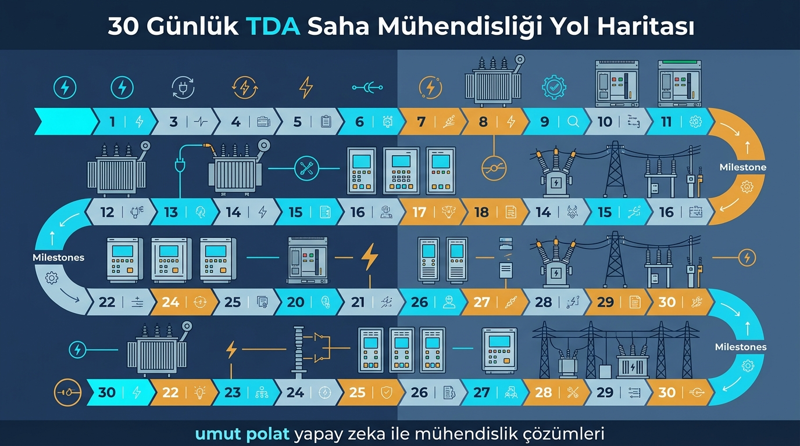

# ⚡ Test ve Devreye Alma (TDA) Saha Mühendisliği Yol Haritası
Bu açık kaynak rehber, **Test ve Devreye Alma (TDA) Saha Mühendisliği** alanında yetkinlik kazanmak isteyen mühendisler için hazırlanmış 30 günlük bir çalışma maratonudur.

Amacımız; teorik bilginin ötesine geçerek OG/YG şalt sahaları, primer/sekonder testler, koruma röleleri, otomasyon ve saha emniyet prosedürlerini kapsayan **yaşayan bir kaynak ve yol haritası** oluşturmaktır.

---

## 🎯 Projenin Amacı
- **Açık kaynak kütüphane:** Saha mühendisliğine yeni başlayan veya kendisini geliştirmek isteyen meslektaşlarımıza pratik bir rehber sunmak.
- **Topluluk katkısı:** Farklı sahalarda tecrübe edinmiş mühendislerin PR (Pull Request) ile tecrübelerini ve düzeltmelerini ekleyebileceği ortak bir hafıza oluşturmak.
- **Sürdürülebilir gelişim:** Günlük commit ve güncellemelerle teknik seviyeyi şeffaf şekilde belgelemek.

---

## 📖 Nasıl Kullanılır?

Her günün klasöründe:

- **`README.md`** — Günün hedefleri, özet çalışma notları ve görsel şema.
- **`detail.md`** — Teknik detaylar, hesap örnekleri, kabul kriterleri ve saha test prosedürleri.
- **`assets/`** — O günün konusuna ait görseller.

**Önerilen çalışma düzeni:** Önce günün özetini incele, ardından detaylı notlara geç. Saha uygulamalarında daima onaylı proje dokümanlarını, üretici talimatlarını, güncel standartları ve yetkili işletme prosedürlerini esas al.

---

## 🗺️ 30 Günlük Yol Haritası
| Gün | Bölüm | Konu | İçerik odağı | Sayfa |
|:---:|:---|:---|:---|:---:|
| **01** | Primer ekipmanlar | Şalt mimarisi ve tek hat şemaları | AIS/GIS, fider yapısı, kilitleme | [Notlar](./Day-01/) |
| **02** | Primer ekipmanlar | Güç trafoları ve testleri | Vektör grubu, TTR, izolasyon ve sargı direnci, yağ analizleri | [Notlar](./Day-02/) |
| **03** | Primer ekipmanlar | Kesiciler, ayırıcılar ve ölçü trafoları | SF₆/vakum kesiciler, zamanlama, CT/VT polarite ve doyma | [Notlar](./Day-03/) |
| **04** | Sekonder sistemler ve koruma | DC kumanda, akü ve redresör | DC barası, yedekleme, kesici bobinleri | [Notlar](./Day-04/) |
| **05** | Sekonder sistemler ve koruma | Koruma röleleri ve IED temelleri | ANSI işlevleri, koruma zonları, seçicilik ve yedeklilik | [Notlar](./Day-05/) |
| **06** | Sekonder sistemler ve koruma | Aşırı akım ve toprak koruması | 50/51, 50N/51N, IDMT, koordinasyon ve 67 | [Notlar](./Day-06/) |
| **07** | Sekonder sistemler ve koruma | Diferansiyel koruma | 87, bias, trafo diferansiyeli ve inrush engelleme | [Notlar](./Day-07/) |
| **08** | Sekonder sistemler ve koruma | Mesafe koruması | 21, empedans, zonlar, karakteristikler ve güç salınımı | [Notlar](./Day-08/) |
| **09** | Sekonder sistemler ve koruma | Sekonder enjeksiyon testleri | Röle ayarları, pick-up, açma süresi ve çıkış kontakları | [Notlar](./Day-09/) |
| **10** | Haberleşme ve emniyet | SCADA ve IEC 61850 | MMS, GOOSE, SV, RTU, SCL ve IEC 104 | [Notlar](./Day-10/) |
| **11** | Haberleşme ve emniyet | Saha emniyeti ve LOTO | Güvenli izolasyon, kilitleme/etiketleme, risk ve manevra planı | [Notlar](./Day-11/) |
| **12** | Haberleşme ve emniyet | Kompakt şalt ve RMU | Hücre mimarisi, gösterge ve güvenli çalışma | [Notlar](./Day-12/) |
| **13** | Test ve komisyonlama | OG kablo testleri | VLF, tan delta, kısmi boşalma ve ekran | [Notlar](./Day-13/) |
| **14** | Test ve komisyonlama | Parafudr ve aşırı gerilim | MOV, koruma seviyesi, koordinasyon ve kaçak akım | [Notlar](./Day-14/) |
| **15** | Test ve komisyonlama | Fider komisyonlama | Test sırası, ayar yönetimi ve test dosyası | [Notlar](./Day-15/) |
| **16** | İleri koruma | Güç trafosu korumaları | 87T, REF, Buchholz, DGA, sıcaklık ve V/Hz | [Notlar](./Day-16/) |
| **17** | İleri koruma | Bara diferansiyel koruması | 87B, CT kararlılığı ve bara zonları | [Notlar](./Day-17/) |
| **18** | İleri koruma | Kesici arızası yedek koruması | 50BF, lockout (86), trip matrisi ve yedek açma | [Notlar](./Day-18/) |
| **19** | İleri koruma | Frekans ve gerilim korumaları | 81, 27/59, yük atma ve ada koruması | [Notlar](./Day-19/) |
| **20** | Devreye alma | Otomatik tekrar kapama | 79, ölü zaman, senkron kontrol ve engelleme | [Notlar](./Day-20/) |
| **21** | Devreye alma | Güç trafosu devreye alma | İlk enerjileme, inrush ve ilk izleme | [Notlar](./Day-21/) |
| **22** | Devreye alma | Jeneratör senkronizasyonu | Gerilim, frekans, faz açısı ve 25 işlevi | [Notlar](./Day-22/) |
| **23** | Devreye alma | Motor devreye alma | Yol vericiler, koruma, yalıtım ve çalışma testleri | [Notlar](./Day-23/) |
| **24** | Ölçüm ve tesisat | Reaktif güç kompanzasyonu | Güç faktörü, kademeler, harmonikler ve rezonans | [Notlar](./Day-24/) |
| **25** | Ölçüm ve tesisat | Ölçü trafoları ve burden | CT/VT sınıfları, burden, diz noktası ve güvenlik | [Notlar](./Day-25/) |
| **26** | Kabul ve dokümantasyon | Topraklama ve yıldırımdan korunma | TT/TN/IT, ölçüm, LPS ve SPD koordinasyonu | [Notlar](./Day-26/) |
| **27** | Kabul ve dokümantasyon | Test dosyası ve kayıt yönetimi | Prosedür, kalibrasyon, revizyon ve uygunsuzluk | [Notlar](./Day-27/) |
| **28** | Kabul ve dokümantasyon | Saha kabulü ve punch list | İnşaat, mekanik, elektrik ve emniyet kontrolleri | [Notlar](./Day-28/) |
| **29** | SCADA ve bütünleşik uygulama | SCADA point testleri | DI/DO/AI/AO, uzaktan kumanda ve olay sıralaması | [Notlar](./Day-29/) |
| **30** | SCADA ve bütünleşik uygulama | Bütünleşik TDA simülasyonu | Komisyonlama akışı, roller, kararlar ve teslim | [Notlar](./Day-30/) |

---

## 🎓 Kimler İçin?

- **Yeni mezun elektrik mühendisleri** — sahaya çıkmadan önce temel kavramları oturtmak için.
- **Saha mühendisleri** — bilgi boşluklarını doldurmak ve referans rehber edinmek için.
- **Tasarım mühendisleri** — tasarımlarının sahada nasıl test edildiğini anlamak için.
- **Teknik öğrenciler** — pratik saha bilgisi edinmek için.

---

## 🤝 Katkıda Bulunma
Bu projenin toplulukla birlikte büyümesini hedefliyoruz!

1. Bu depoyu **fork** edin.
2. Yeni bir gün veya mevcut günlerde eksik/hatalı gördüğünüz bir konu için branch oluşturun (`feature/day-XX-ekleme`).
3. Değişikliklerinizi yapıp **Pull Request (PR)** açın.

**Katkı formatı:** Her gün için `README.md` (özet), `detail.md` (detay) ve `assets/` altında konuya uygun en az bir görsel ekleyin.

---

## 📄 Lisans
Bu proje eğitim amaçlı açık kaynak olarak sunulmaktadır.
